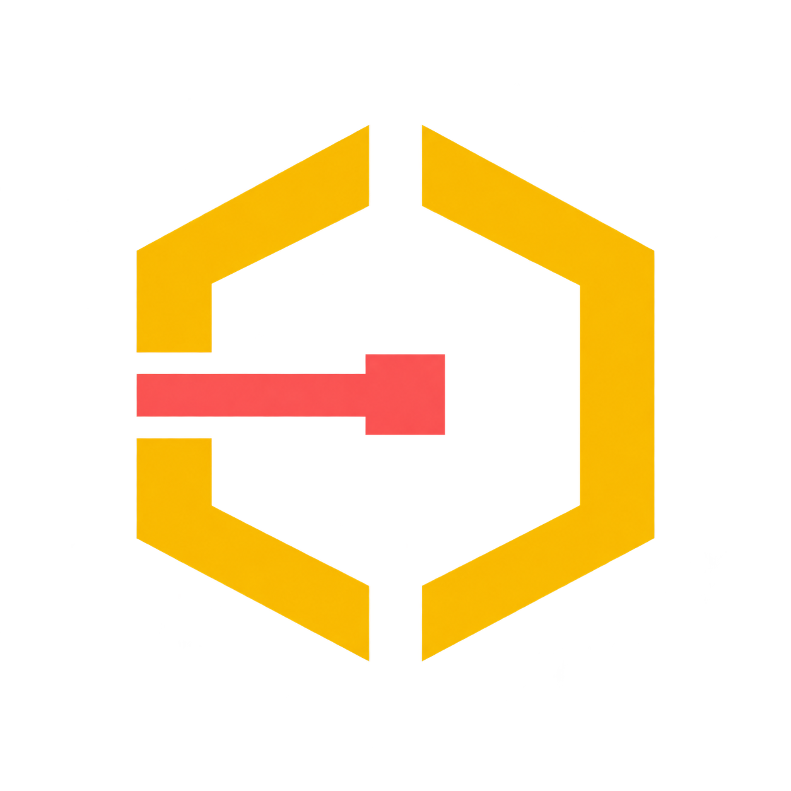

# Boundary Lab

  

  
  

Boundary Lab is a set of safety and security tools for chatbots and the apps around them. You can run the examples, see what happens, and use the code in your own projects.

The idea is simple: show how the checks work with code you can actually use. Test whether a chatbot follows your rules. Check what a user is allowed to do. See what gets caught and what slips through.

It's for developers building apps, security people testing them, and anyone who wants to learn how these checks work.

## Projects

| Project | What you can do with it | Get started |
| --- | --- | --- |
| **Redline** | Check chatbot answers against your rules. See which problems it catches, what it misses, and which good answers it flags by mistake. | [Redline README](redline/README.md) |
| **Latch** | Check a tool call before your app runs it. Add permissions, approval steps, and limits on what can happen. | [Latch README](tools/latch/README.md) |

Each project works on its own. Pick the one you need and open its README for setup, examples, settings, results, and limits.

## Start with an example

Start with the included example. Change a rule or permission and see what happens. Then try your own data or connect your own functions.

The examples use made-up businesses and data, so you can try things without connecting a real customer account. Each project explains what it checks, what it misses, and what your app still needs to handle.

## Help improve it

If a step is confusing, a check misses something, or another example would help, open an issue. See [Contributing](CONTRIBUTING.md) to make a change.

Copyright (c) 2026 Matt Grofsky. Licensed under the GNU Affero General Public License, version 3 only (AGPL-3.0-only). See [LICENSE](LICENSE).
